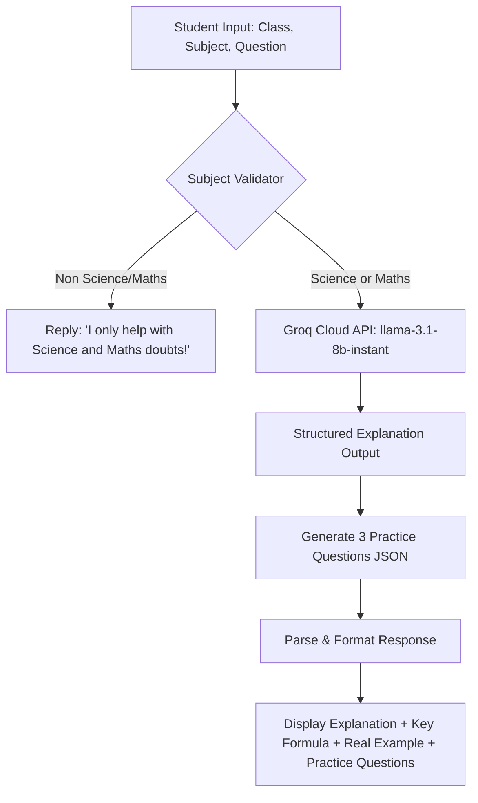

# EduSolve 🎓

> **AI-Powered Learning & Doubt-Solving Platform for Class 9 & 10 Students**

[](https://www.python.org/)
[](https://console.groq.com)
[](https://huggingface.co/meta-llama)
[](https://opensource.org/licenses/MIT)
[](https://github.com/aryan-65548/Edusolve/pulls)

---

## 📖 Table of Contents

- [Overview](#-overview)
- [Key Features](#-key-features)
- [How It Works](#-how-it-works)
- [Prerequisites](#-prerequisites)
- [Setup & Installation Guide](#-setup--installation-guide)
- [Usage Guide](#-usage-guide)
  - [1. Interactive CLI Mode](#1-interactive-cli-mode)
  - [2. Programmatic Python API](#2-programmatic-python-api)
- [Environment Variables](#-environment-variables)
- [Project Structure](#-project-structure)
- [System Architecture & Roadmap](#-system-architecture--roadmap)
- [Model Configuration](#-model-configuration)
- [Troubleshooting](#-troubleshooting)
- [Contributing](#-contributing)
- [Team](#-team)
- [License](#-license)

---

## 🌟 Overview

**EduSolve** is an intelligent AI academic tutor built specifically for Indian curriculum (CBSE / State Boards) **Class 9 and 10 students**. It bridges the gap between passive reading and active comprehension by solving doubts with pedagogical clarity and reinforcing knowledge through instant, auto-generated practice questions.

Instead of generic, overwhelming answers, EduSolve provides:
1. **Age-Appropriate Explanations**: Tailored for 14–16 year olds without unnecessary academic jargon.
2. **Key Formulas & Facts**: Quick takeaways students can memorize or highlight in revision notes.
3. **Real-Life Examples**: Everyday analogies connecting abstract concepts to the physical world.
4. **Immediate Active Recall**: Instant MCQ and short-answer practice questions generated directly from the doubt's context.

---

## ⚡ Key Features

- 🎯 **Domain-Specific Guardrails**: Dedicated strictly to **Science** and **Mathematics**. Unrelated questions are filtered out to keep students focused.
- 📝 **Structured 3-Part Pedagogical Answers**:
  - `EXPLANATION`: Step-by-step conceptual walkthrough.
  - `KEY FORMULA / FACT`: Core principles, equations, and definitions.
  - `REAL EXAMPLE`: Relatable everyday applications.
- 🔄 **Automated Practice Generator**: Generates 3 contextual practice questions (MCQ + Short Answer) with complete solutions to test understanding.
- ⚡ **Ultra-Fast Groq Inference**: Powered by Groq's LPU™ (Language Processing Unit) and `llama-3.1-8b-instant` for sub-second response times.
- 💻 **Dual Interface**:
  - Interactive, menu-driven command-line interface (CLI).
  - Clean, reusable Python functions (`solve_doubt`) ready for API and web service integration.
- 🌐 **Full-Stack Ecosystem (In Active Development)**:
  - **Modern Web App**: React (Vite) with sleek glassmorphism UI, soft gradients, and Framer Motion micro-animations.
  - **Backend REST API**: Django REST Framework with JWT authentication, community discussion forums, and progress tracking.

---

## 🧠 How It Works



---

## 📋 Prerequisites

Before setting up EduSolve, ensure you have:

- **Python 3.8+** (Python 3.10 or higher recommended)
- **Git** installed on your system
- A free **Groq Cloud API Key** — obtain one at [console.groq.com/keys](https://console.groq.com/keys)

---

## 🚀 Setup & Installation Guide

Follow these steps to set up and run the EduSolve engine locally:

### 1. Clone the Repository

```bash
git clone https://github.com/aryan-65548/Edusolve.git
cd Edusolve
```

### 2. Create and Activate a Virtual Environment

It is recommended to use an isolated Python virtual environment:

**On macOS / Linux:**
```bash
python3 -m venv venv
source venv/bin/activate
```

**On Windows (Command Prompt):**
```cmd
python -m venv venv
venv\Scripts\activate
```

**On Windows (PowerShell):**
```powershell
python -m venv venv
.\venv\Scripts\Activate.ps1
```

### 3. Install Dependencies

Install all required Python packages using `pip`:

```bash
pip install -r requirements.txt
```

### 4. Configure Environment Variables

Create a `.env` file in the project root directory:

```bash
cp .env.example .env
```

Open `.env` in your text editor and add your Groq API key:

```env
GROQ_API_KEY=gsk_your_actual_groq_api_key_here
```

> [!IMPORTANT]
> Never commit your `.env` file or expose your API key publicly.

---

## 💻 Usage Guide

### 1. Interactive CLI Mode

Launch the interactive terminal tutor:

```bash
python ai_engine.py
```

#### Example Session:

```text
============================================================
         Welcome to EduSolve AI Tutor 🎓
     For Class 9 & 10 | Science & Maths
============================================================
Enter your Class (9 or 10): 9

Choose Subject:
  1. Science
  2. Maths
Enter 1 or 2: 1

Type your doubt/question: Why does an object float or sink in water?

 Thinking about: Why does an object float or sink in water?

============================================================
ANSWER:
============================================================
EXPLANATION:
Whether an object floats or sinks depends on its density compared to the density of water.
If an object is less dense than water, the buoyant force exerted by water pushes it up, causing
it to float. If the object has a higher density than water, gravity pulls it down with more
force than buoyant upthrust, causing it to sink.

KEY FORMULA / FACT:
Density = Mass / Volume (ρ = m / V). If Density(object) < Density(water) (1 g/cm³), it floats;
if Density(object) > Density(water), it sinks.

REAL EXAMPLE:
An iron nail sinks in water because iron is much denser than water, but a huge ship made of iron
floats because its hollow shape encloses a vast amount of air, making its overall average density
less than that of water.

============================================================
PRACTICE QUESTIONS:
============================================================

Q1 [MCQ]: An iron pin sinks in water whereas a cork floats. This is because:
   Answer: The density of iron is greater than water, while cork is less dense than water.

Q2 [SHORT]: State Archimedes' Principle in simple words.
   Answer: When a body is immersed fully or partially in a fluid, it experiences an upward force equal to the weight of the fluid displaced by it.

Q3 [SHORT]: If an object has a mass of 50g and a volume of 20cm³, will it float or sink in water? (Density of water = 1 g/cm³)
   Answer: Sinks. (Density = 50 / 20 = 2.5 g/cm³, which is greater than 1 g/cm³).

------------------------------------------------------------
Ask another doubt? (yes/no):
```

---

### 2. Programmatic Python API

You can import and use EduSolve's modular functions in backend services or custom scripts:

```python
from ai_engine import solve_doubt

# Submit a student doubt
result = solve_doubt(
    question="State Pythagoras theorem and give a formula",
    subject="Maths",
    grade=10
)

# Output structure
print("Answer:\n", result["answer"])
print("\nPractice Questions:")
for q in result["practice_questions"]:
    print(f"- [{q['type']}] {q['question']}")
    print(f"  Ans: {q['answer']}")
```

#### Available Functions in `ai_engine.py`:

| Function | Parameters | Returns | Description |
|---|---|---|---|
| `ask_doubt()` | `question: str, subject: str, grade: int` | `str` | Returns formatted 3-part answer from Groq LLM |
| `get_practice_questions()` | `ai_answer: str, subject: str, grade: int` | `list[dict]` | Generates 3 practice questions with answers in JSON format |
| `solve_doubt()` | `question: str, subject: str, grade: int` | `dict` | High-level orchestrator returning combined answer & practice set |

---

## 🔑 Environment Variables

| Variable | Description | Required | Example |
|---|---|---|---|
| `GROQ_API_KEY` | Groq Cloud API Key for LPU model inference | **Yes** | `gsk_abc123456789...` |

---

## 📂 Project Structure

```text
Edusolve/
├── .env.example          # Template for required environment variables
├── .gitignore            # Git ignore file for Python cache & credentials
├── README.md             # Project documentation & setup guide
├── requirements.txt      # Python package dependencies
└── ai_engine.py          # Core AI doubt-solving engine & CLI interface
```

---

## 🏗️ System Architecture & Roadmap

EduSolve is evolving into a full-stack educational ecosystem:

```text
┌────────────────────────────────────────────────────────┐
│                   Frontend (React + Vite)              │
│   • Glassmorphism Design  • Framer Motion Animations   │
│   • Doubt Asking Studio   • Interactive Quiz Solver    │
└───────────────────────────┬────────────────────────────┘
                            │ REST API (JSON)
┌───────────────────────────▼────────────────────────────┐
│              Backend (Django REST Framework)           │
│   • User Authentication & Profiles (JWT)               │
│   • Doubts & Solution History Management               │
│   • Community Forums, Threads, & Discussion Boards     │
└───────────────────────────┬────────────────────────────┘
                            │ Internal Call / Workers
┌───────────────────────────▼────────────────────────────┐
│                    AI Engine (Groq LPU)                │
│   • llama-3.1-8b-instant (Sub-second response)         │
│   • Class 9/10 Science & Maths Academic Guardrails     │
│   • Automated Practice Generation with Auto-Grading    │
└────────────────────────────────────────────────────────┘
```

---

## ⚙️ Model Configuration

The default model is set to `llama-3.1-8b-instant` in `ai_engine.py` for blazing-fast inference:

```python
MODEL = "llama-3.1-8b-instant"
```

If you require deeper reasoning or complex mathematical derivations, you can switch to 70B parameter models by modifying line 15 in `ai_engine.py`:

- `"llama-3.3-70b-versatile"` *(Recommended for advanced derivations)*
- `"llama-3.1-70b-versatile"`

---

## ❓ Troubleshooting

### 1. `groq.AuthenticationError` or `API key not found`
- **Cause**: The `GROQ_API_KEY` environment variable is missing or invalid.
- **Fix**: Check that your `.env` file exists in the root directory and contains `GROQ_API_KEY=your_key`. Ensure you called `load_dotenv()` or export the key in your terminal (`export GROQ_API_KEY="your_key"`).

### 2. `ModuleNotFoundError: No module named 'groq'`
- **Cause**: Dependencies are not installed in the active environment.
- **Fix**: Verify your virtual environment is active (`source venv/bin/activate` or `venv\Scripts\activate`), then run `pip install -r requirements.txt`.

### 3. Out-of-Domain Rejections
- **Behavior**: If you ask questions about History, Geography, or General Trivia, the engine replies:
  ```text
  "I only help with Science and Maths doubts!"
  ```
- **Reason**: This is an intentional pedagogical guardrail to keep the system specialized for CBSE Class 9 & 10 Science and Maths curricula.

---

## 🤝 Contributing

Contributions are welcome! Please follow these steps:

1. **Fork** the repository
2. **Create a Feature Branch**:
   ```bash
   git checkout -b feature/amazing-feature
   # or for docs:
   git checkout -b docs/setup-guide
   ```
3. **Commit Your Changes**:
   ```bash
   git commit -m "feat: add amazing feature"
   ```
4. **Push to the Branch**:
   ```bash
   git push origin feature/amazing-feature
   ```
5. **Open a Pull Request** against the `main` branch.

---

## 👥 Team

EduSolve is built with ❤️ by a team of passionate student developers:

- **Aryan Patel**
- **Rudra Bhungaliya**
- **Vishvarajsinh Zala**
- **Team Collaborators**

---

## 📄 License

This project is licensed under the [MIT License](LICENSE).
